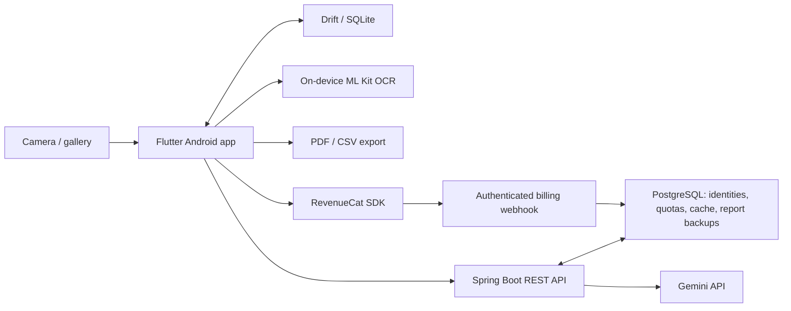

# HomeVault

**Flutter Android application + Java/Spring Boot backend for AI-assisted home inventory.**

Photograph a room, review suggested items and estimated replacement-value ranges,
and generate a PDF inventory report. Recognition is a suggestion: the user reviews
the results. HomeVault is not an appraisal service or insurance advice.

**Status:** local prototype and portfolio project. No Google Play release,
production deployment, paying users, or commercial performance is claimed.
The author developed both the mobile application and backend using AI-assisted
development. This repository contains the implementation, not evidence of a launch.

## Features

- Camera/gallery capture and upload image preparation.
- Gemini integration with structured responses and server-side validation.
- Item review, editing, deletion/undo, and explicit low-confidence confirmation.
- Local SQLite inventory and persistent analysis jobs with retry support.
- On-device label OCR for serial/model candidates.
- PDF reports, sharing, and Pro-gated CSV export.
- Optional PDF report backups and transfer codes; this is not inventory sync.
- Device authentication, analysis quotas, and a daily analysis budget.
- RevenueCat integration and a Kotlin bridge for Google Play Integrity.

Purchases and Play Integrity require real store/provider configuration.
Neither integration is presented as live in this prototype.

## Architecture



Inventory and original photos live on the device. Compressed photos leave the
device for analysis. PDF backups can contain inventory details and photo thumbnails.

| Area | Technologies |
| --- | --- |
| Android client | Flutter/Dart, Riverpod, go_router, Drift/SQLite |
| OCR and reports | ML Kit, PDF generation, share_plus |
| Backend | Java 21, Spring Boot 4.1, PostgreSQL, Flyway, Spring Security |
| Integrations | Gemini REST API, RevenueCat, Play Integrity |
| Delivery | Docker, GitHub Actions |

## Repository layout

| Path | Purpose |
| --- | --- |
| `lib/`, `android/` | Mobile application and Android host |
| `server/` | Spring Boot application, migrations, Docker configuration |
| `test/` | Mobile unit/widget tests |
| `integration_test/` | Mobile flow test using a fake server |
| `docs/` | Review, release limitations, draft privacy materials |
| `scripts/` | Publication checks |

## Run locally

Prerequisites: Flutter **3.44.8** (Dart 3.12.2), Java **21**, Maven **3.9+**,
Docker for development PostgreSQL, and an Android emulator/device.

### Backend: local mock mode

Mock mode exercises the app/server workflow without sending photos to an AI provider.
Commands below are for PowerShell:

```powershell
cd server
docker compose up -d
$secretBytes = [byte[]]::new(32)
[System.Security.Cryptography.RandomNumberGenerator]::Fill($secretBytes)
$env:AUTH_SECRET = [Convert]::ToBase64String($secretBytes)
$env:GEMINI_MOCK = 'true'
mvn spring-boot:run
```

The database port is bound to localhost. Its sample credentials are for local
development only. Keep `AUTH_SECRET` stable across development restarts if you
want existing tokens to remain valid. Never commit it.

`server/.env.example` lists variables; Spring Boot does not automatically load
a copied `.env` file. Set variables in your shell/deployment environment.
For real recognition, set `GEMINI_API_KEY` and disable `GEMINI_MOCK`; calls may
incur costs. Use synthetic/non-sensitive photos for a demonstration.

### Android application

In another terminal, from the repository root:

```powershell
flutter pub get
dart run build_runner build --delete-conflicting-outputs
flutter gen-l10n
flutter run --dart-define=API_BASE_URL=http://10.0.2.2:8080
```

`10.0.2.2` reaches the host from the standard Android emulator. A physical device
needs a reachable server address. HTTP is a development setting; use HTTPS when
exposing the API.

## Checks

```powershell
python scripts/check_publication.py
flutter analyze --fatal-infos
flutter test
cd server
mvn test
```

Generate Dart/localization outputs before analysis/tests. GitHub Actions runs
generation, Flutter analysis/tests, backend tests, and a Docker build. A configured
workflow is not a passing run. See [verification notes](docs/publication-review.md)
for the checks actually performed for this snapshot.

The mobile flow test requires a device/emulator and uses a fake server; it does
not verify real Gemini behavior or purchases:

```powershell
flutter test integration_test/app_flow_test.dart -d <device-id> --dart-define=API_BASE_URL=http://127.0.0.1:9
```

## Authentication compatibility

Registration requires an independent random `device_secret`: secure storage on
the app, SHA-256 hash on the server. A public `device_id` alone cannot renew a token.

Migration V4 adds the hash. Legacy rows have no ownership proof and cannot renew
using a newly supplied secret; existing JWTs remain valid until expiry. Evaluate
the new flow with a fresh development database/app install, or design an
authenticated migration before retaining old identities. Export needed data first.

## Release limitations

Source publication and an operational app release are separate steps. See
[release limitations](docs/release-limitations.md) for remaining deployment work.
Privacy and Play Data Safety documents are drafts requiring verified hosting,
provider configuration, retention behavior, and contact details before distribution.

## License and attribution

Application source is licensed under the [MIT License](LICENSE), selected by the
author. Bundled Noto Sans retains its SIL Open Font License in
`assets/fonts/OFL.txt`; dependency licenses remain with their owners.
